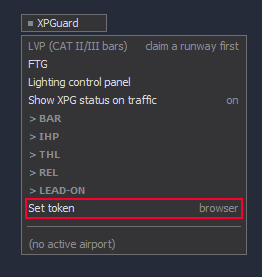

# Installation

The plugin is linked to your account once. You do not need to enter a token manually:

1. Go to [xpguard.net](https://xpguard.net/) and create an account.
2. In EuroScope, open the XPGuard menu and click **Set token**. Your browser opens.
3. On the XPGuard page, click **Approve**.

