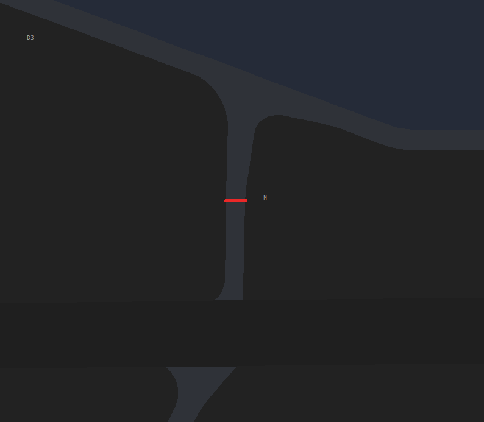
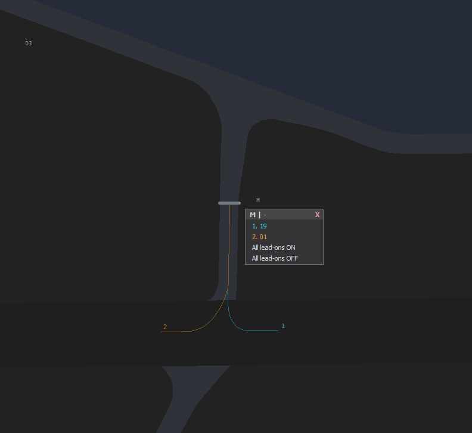
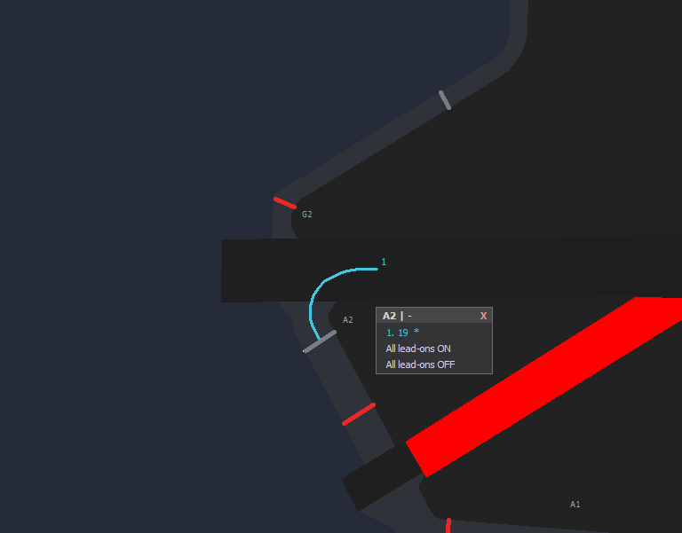
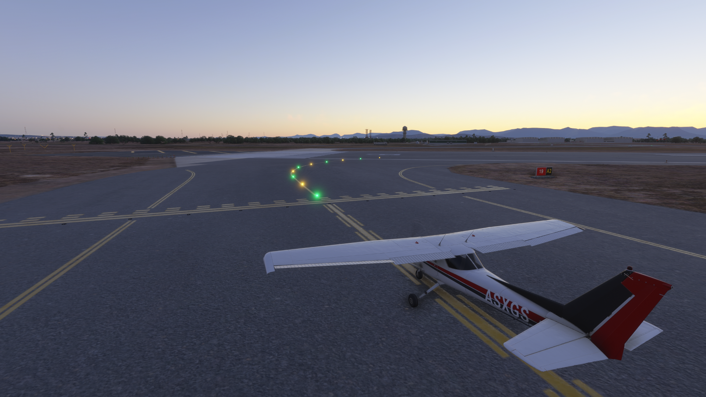
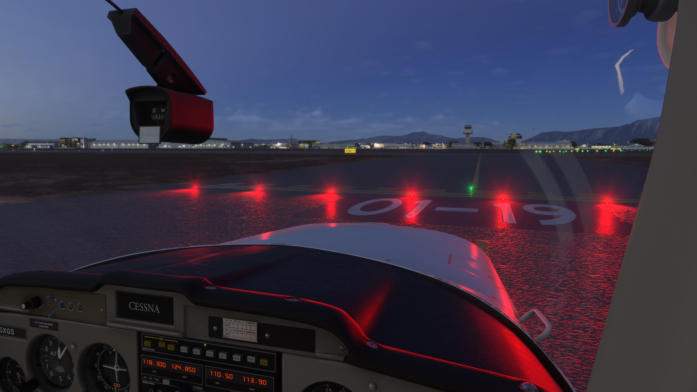
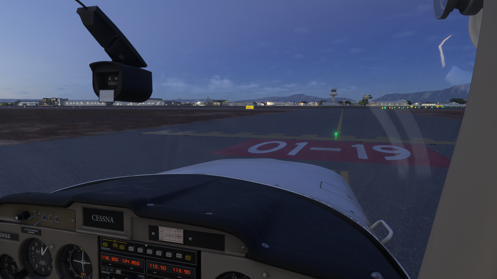

# Usage

## Understanding the lights

=== "Stop bars"

    Red lights across a holding position. Pilots hold short at red. When you clear
    the bar it switches off.

=== "THL / REL"

    Runway Status Lights (RWSL), driven automatically by live traffic:

    - **THL (Takeoff Hold Lights):** red means the aircraft lined up must not start the takeoff roll.
    - **REL (Runway Entrance Lights):** red means traffic must not enter or cross the runway.

    These simulate A-SMGCS and help prevent runway incursions.

## Claiming runways

- Only the responsible **tower** claims **its own** runways. Grounds do not claim runways.
- A runway can be claimed by **one person at a time**.

## Controlling the lights

Click a stop bar in EuroScope to switch it on or off in the simulator.

When you switch a bar off, a small window opens where you choose the lead-on lights.

Pick a lead-on direction and it previews on your screen. The lead-on lights the green
line that traffic follows onto the runway (line-up) or across it.

The pilot then sees the lit lead-on in the simulator:

Lead-on options follow the real-world layout. A crossing, or a particular direction,
only appears where real taxiway lines actually lead onto or across the runway. If it
does not exist in real life, it is not offered.

**REL and THL** arm per runway and follow live traffic automatically.

### What the pilot sees

Bar red: hold short.

Bar cleared: the bar is dark.

