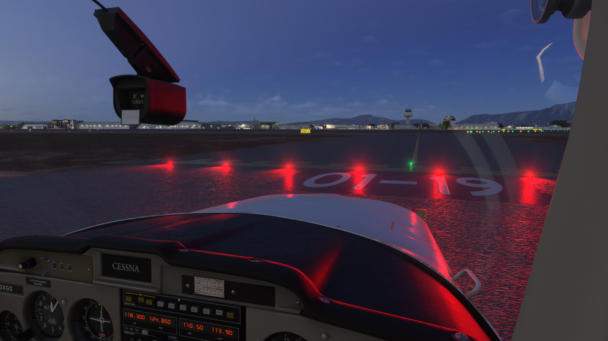
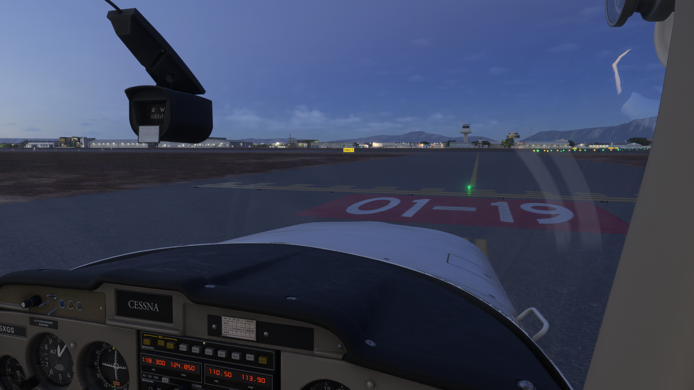
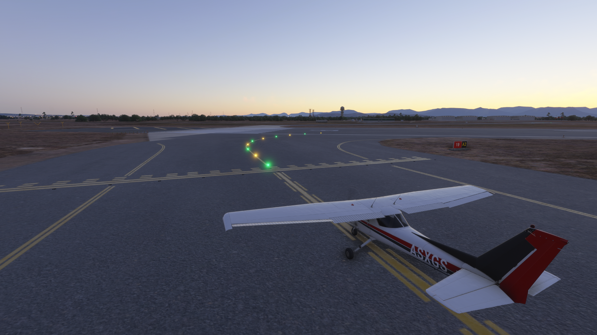

# XPGuard

XPGuard shows ATC-controlled airport ground lighting in your simulator while you fly
on VATSIM. A controller sets the lights from their radar screen, and you see them on
the ground in MSFS or X-Plane.

XPGuard is freeware for personal, non-commercial use.

On VATSSA you will see these lights when a controller is online:

- **Stop bars:** red across a holding position.
- **Takeoff Hold Lights (THL)** and **Runway Entrance Lights (REL):** Runway Status Lights.

!!! warning "Lights do not replace ATC clearances"
    Always follow your controller's instructions. A stop bar switching off does not
    by itself mean you are cleared to proceed.

## Download

Get XPGuard for your simulator from the official website: [xpguard.net](https://xpguard.net/).

## What the lights mean

=== "Stop bars"

    Red lights across a holding position: hold short. When the controller clears the
    bar, it switches off. Only move once you have a taxi clearance.

    

    

=== "THL / REL"

    Runway Status Lights, driven automatically by traffic:

    - **THL red:** do not start your takeoff roll.
    - **REL red:** do not enter or cross the runway.

    They warn of unsafe runway conditions and help you avoid runway incursions.

## Lead-on lights

When a controller clears you onto or across a runway, green lead-on lights show the
line to follow.

!!! note "Coverage depends on the airport map"
    XPGuard uses base airport data plus community corrections. If a stop bar looks
    misplaced for your scenery, check the [coverage map](https://xpguard.net/) or
    report it on the XPGuard Discord.

## Lights staying dark?

If you see no lights, the most common cause is that no XPGuard controller is online at
that airport. Then the stop bars stay dark by design. For other issues, see
[I cannot see the lights](https://xpguard.net/docs/help/no-lights/).

## Resources

- [XPGuard website](https://xpguard.net/)
- [XPGuard documentation](https://xpguard.net/docs/)
- [Live status](https://xpguard.net/live)
- [XPGuard Discord](https://discord.gg/ARXkGQTWKC)
