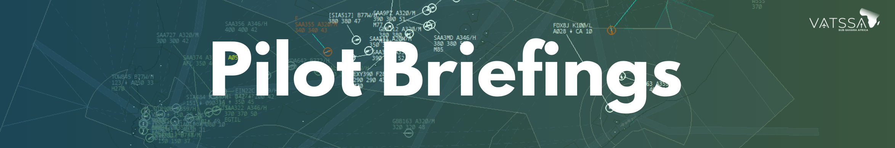

# Overview

## Purpose
This page is intended to boost the knowledge of pilots, making it easier for our approved controllers and for you to understand the flying side of the network. This covers tools used by pilots, things that are expected by VATSIM and controllers, as well as pilot briefings to help you with local procedures.

The following documentation provides essential pilot resources and briefings, split by country. This section covers important information for flying in VATSSA airspace, including preferred routes, airport-specific procedures, and general airspace knowledge.

The procedures outlined in this documentation should take priority should discrepancies arise regarding the outlining of procedures.

## Exclusion of Liability

!!! warning
    All documentation in this section is intended solely for use on the VATSIM network and must not be used for real-world aviation operations. The authors disclaim any liability for personal injury or death resulting from misuse of this material.
